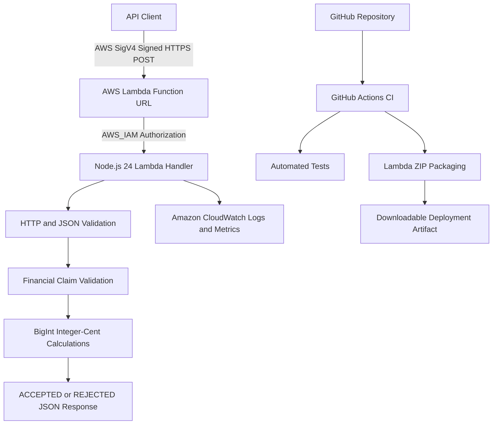

# RevenueGuard AWS — Serverless Financial Claim Validation

**AWS Lambda | Node.js 24 | Python | GitHub Actions | Amazon CloudWatch | AWS IAM**

RevenueGuard-AWS is a serverless financial claim-validation API deployed on AWS Lambda. It validates submitted financial claims against a fixed, synthetic dataset using exact integer-cent arithmetic, automated regression tests, and authenticated HTTPS requests.

The project demonstrates backend API development, serverless deployment, request validation, security testing, CI/CD packaging, performance measurement, and cloud observability.

**Project status:** Deployed and verified on AWS Lambda.

**Repository:** https://github.com/yusufthecoder474/RevenueGuard-AWS

> This is a portfolio demonstration using synthetic, hard-coded transactions. It is not a production financial service and does not process real customer financial data.

---

## Architecture



### Request lifecycle

1. An authorized client sends an AWS Signature Version 4-signed HTTPS request.
2. The Lambda Function URL enforces `AWS_IAM` authentication.
3. The Node.js Lambda handler validates the HTTP method, request body, JSON structure, and supported claims.
4. The application calculates trusted financial totals from synthetic records using integer cents.
5. Submitted claims are compared with the calculated values.
6. The API returns a JSON response containing validation results.
7. AWS Lambda sends runtime logs and execution metrics to Amazon CloudWatch.

---

## Core Features

### Financial claim validation

The demonstration uses three synthetic transactions:

| Transaction | Type | Amount |
|---|---|---:|
| INV-101 | Sale | 500.00 |
| INV-102 | Sale | 750.00 |
| REF-103 | Refund | 125.00 |

Calculated totals:

| Claim | Trusted value |
|---|---:|
| Gross sales | 1250.00 |
| Refunds | 125.00 |
| Net sales | 1125.00 |

The API supports validation of these three financial claim categories.

### Exact arithmetic

JavaScript `BigInt` integer-cent calculations are used to avoid floating-point rounding problems in financial comparisons.

### Input validation

The application validates:

- Supported claim identifiers and types
- Claim count limits of 1–20
- Duplicate claims
- Numeric amount formatting
- Invalid or unsupported values
- Malformed JSON
- Unsupported HTTP methods
- Oversized HTTP request bodies
- Invalid encoding and malformed request payloads

### API response behavior

| Scenario | HTTP status | Application result |
|---|---:|---|
| Correct financial claim | 200 | ACCEPTED |
| Incorrect financial claim | 200 | REJECTED |
| Unsupported HTTP method | 405 | REJECTED |
| Malformed JSON | 400 | REJECTED |
| Oversized request body | 413 | REJECTED |

Business-rule rejections are distinguished from malformed HTTP requests.

---

## Technology Stack

| Layer | Technology |
|---|---|
| Programming languages | JavaScript, Python |
| Serverless computing | AWS Lambda |
| Runtime | Node.js 24 |
| HTTP endpoint | AWS Lambda Function URL |
| Authentication | AWS IAM, AWS Signature Version 4 |
| Financial arithmetic | JavaScript BigInt |
| Automated testing | Node.js built-in test runner, Python |
| Cloud SDK | Boto3, Botocore |
| CI and packaging | GitHub Actions |
| Monitoring | Amazon CloudWatch |
| Version control | Git, GitHub |

---

## Repository Structure

```text
RevenueGuard-AWS/
├── .github/
│   └── workflows/
│       ├── ci.yml
│       └── package.yml
├── source/
│   └── index.mjs
├── test_local.mjs
├── test_security.mjs
├── test_phase3.mjs
├── test_revenueguard.py
├── test_revenueguard_http.py
├── README.md
└── .gitattributes
```

### File descriptions

- `source/index.mjs` — AWS Lambda financial validation handler.
- `test_local.mjs` — Local business-rule regression tests.
- `test_security.mjs` — Security and boundary regression tests.
- `test_phase3.mjs` — HTTP request validation and security tests.
- `test_revenueguard.py` — AWS Lambda integration tests.
- `test_revenueguard_http.py` — AWS HTTP-event integration tests.
- `.github/workflows/ci.yml` — Automated credential-free validation and regression testing.
- `.github/workflows/package.yml` — Automated Lambda ZIP packaging, verification, and downloadable GitHub Actions artifact.

---

## Local Development

### Requirements

- Node.js 24
- Git
- Python 3 for optional AWS integration and benchmarking scripts
- AWS CLI and AWS credentials for deployment or live integration tests

### Clone the repository

```bash
git clone https://github.com/yusufthecoder474/RevenueGuard-AWS.git
cd RevenueGuard-AWS
```

### Verify JavaScript syntax

```bash
node --check source/index.mjs
```

### Run automated tests

```bash
node --test test_local.mjs test_security.mjs test_phase3.mjs
```

**Previously verified result: 30/30 Node.js test-runner tests passed.**

The original 11 business-validation scenarios are grouped into one Node.js runner test in the combined result. The combined runner count must not be interpreted as the arithmetic sum of every separately reported scenario.

---

## AWS Deployment

### Verified configuration

| Configuration | Value |
|---|---|
| AWS service | Lambda |
| Function | revenueguard-validation-api |
| Region | ap-southeast-2 |
| Runtime | nodejs24.x |
| Handler | index.handler |
| Memory | 128 MB |
| Timeout | 3 seconds |
| Function URL authentication | AWS_IAM |
| Function state | Active |
| Last update status | Successful |

### Package the Lambda function

The Lambda deployment archive must contain `index.mjs` at its root.

Example:

```bash
cp source/index.mjs index.mjs
zip revenueguard-lambda.zip index.mjs
unzip -l revenueguard-lambda.zip
```

The GitHub Actions packaging workflow also generates a downloadable Lambda ZIP artifact.

### Update an existing Lambda deployment

```bash
aws lambda update-function-code \
  --function-name revenueguard-validation-api \
  --region ap-southeast-2 \
  --zip-file fileb://revenueguard-lambda.zip
```

Wait for the update:

```bash
aws lambda wait function-updated \
  --function-name revenueguard-validation-api \
  --region ap-southeast-2
```

Verify the configuration:

```bash
aws lambda get-function-configuration \
  --function-name revenueguard-validation-api \
  --region ap-southeast-2 \
  --query '{State:State,Update:LastUpdateStatus,Runtime:Runtime,Memory:MemorySize,Timeout:Timeout}' \
  --output json
```

### Verify Function URL authentication

```bash
aws lambda get-function-url-config \
  --function-name revenueguard-validation-api \
  --region ap-southeast-2 \
  --query '{AuthType:AuthType}' \
  --output json
```

Expected authentication mode:

```json
{
  "AuthType": "AWS_IAM"
}
```

Do not change the endpoint to public `NONE` authentication for convenience.

The deployment commands above assume the Lambda function and required IAM resources already exist. They are not a complete first-time AWS infrastructure provisioning procedure.

---

## Continuous Integration and Packaging

Two GitHub Actions workflows are configured.

### RevenueGuard Lambda CI

File: `.github/workflows/ci.yml`

Runs automated local verification and regression tests without storing AWS credentials in GitHub.

### RevenueGuard Lambda Package

File: `.github/workflows/package.yml`

Creates a Lambda deployment ZIP, verifies the packaged contents, and uploads the deployment artifact for download from GitHub Actions.

### Verified GitHub Actions upgrade

An external GitHub Actions maintenance branch was merged through repository pull request #1.

**Pull request:** https://github.com/yusufthecoder474/RevenueGuard-AWS/pull/1

**Merge commit:** `262a1cbbdc1b86fdf42430026db85081b8d83cd6`

Both workflows completed successfully on the merged `main` branch:

- CI run: https://github.com/yusufthecoder474/RevenueGuard-AWS/actions/runs/41219909447
- Packaging run: https://github.com/yusufthecoder474/RevenueGuard-AWS/actions/runs/41219909413

The upgrade addressed GitHub Actions runtime compatibility. These are repository-maintenance results, not an external open-source contribution.

---

## Verification and Test Evidence

### Local regression tests

| Test category | Verified result |
|---|---|
| Original business-validation scenarios | 11/11 |
| Security and boundary tests | 15/15 |
| HTTP security tests | 14/14 |
| Combined Node.js test runner | 30/30 |
| GitHub Actions CI | Passed |

### Initial live AWS verification

- 5/5 direct AWS Lambda SDK invocation tests passed.
- 5/5 authenticated HTTPS Function URL tests passed.
- Tested accepted and rejected financial claims, unsupported HTTP methods, malformed JSON, and oversized bodies.

### Post-deployment regression verification

Following the subsequent deployment:

- AWS Lambda reported `Active`.
- The update status was `Successful`.
- The runtime remained Node.js 24.
- Function URL authentication remained `AWS_IAM`.
- 5/5 HTTP-event regression tests passed.
- 5/5 financial business-rule tests passed.
- 5/5 authenticated HTTPS business-rule tests passed.

**Total post-deployment regression checks: 15/15 across three separate groups.**

The direct Lambda invocation result and the authenticated HTTPS result are separate verification paths.

---

## Controlled AWS Lambda Load Test

A controlled performance test was executed against the deployed AWS Lambda Function URL using authenticated HTTPS requests signed with AWS Signature Version 4.

The test used synthetic financial claims and a Python client running from AWS CloudShell.

### Measured results

| Metric | Result |
|---|---:|
| Total HTTP requests | 30 |
| Concurrent clients | 2 |
| Successful requests | 30 |
| Failed requests | 0 |
| Observed error rate | 0% |
| Total elapsed time | 0.884 seconds |
| Observed throughput | 33.94 requests/second |
| Median (p50) HTTP latency | 33.40 ms |
| p95 HTTP latency | 374.28 ms |
| Maximum HTTP latency | 413.98 ms |

### Interpretation

All 30 requests returned successful application-level validation results.

The measured throughput of **33.94 requests/second** represents the observed throughput of this particular test configuration.

The p95 HTTP latency was **374.28 ms**, considerably higher than the median of **33.40 ms**, indicating variation in observed response times during the short test.

These measurements include client-side HTTP request timing and must not be confused with AWS Lambda's handler execution duration.

### Benchmark limitations

- Only one 30-request run was reported.
- Concurrency was limited to two clients.
- The workload used synthetic data.
- No sustained multi-minute traffic test was performed.
- No maximum-throughput or capacity limit was established.
- No production SLA or high-availability claim is made.
- Cold-start initialization was analyzed separately through CloudWatch.

The result demonstrates a successfully executed, reproducible small-scale load test, not production-scale performance.

---

## Amazon CloudWatch Observability

The deployed function was inspected using Amazon CloudWatch metrics and logs in `ap-southeast-2`.

### Previously observed monitoring metrics

From a selected three-hour monitoring window:

| Metric | Observation |
|---|---:|
| Lambda invocations | 11 |
| Maximum displayed execution error count | 0 |
| Maximum displayed throttles | 0 |
| Average displayed execution duration | 21.85 ms |

These historical monitoring-window metrics are separate from the later 30-request load test.

### Execution log example

A previously verified invocation recorded:

| Metric | Value |
|---|---:|
| Execution duration | 68.58 ms |
| Billed duration | 187 ms |
| Initialization duration | 118.23 ms |
| Configured memory | 128 MB |
| Maximum memory used | 76 MB |

### Additional initialization observations

A later CloudWatch log inspection returned these initialization durations:

- 134.69 ms
- 134.36 ms

These are individual observed initialization records. They do not establish a statistically representative average cold-start latency or a cold-start frequency.

### Historical errors

The broader CloudWatch log history also contained earlier `Runtime.UserCodeSyntaxError` execution errors.

Those historical errors are distinct from the latest successful authenticated load-test results. Their presence means that zero failures in the latest benchmark must not be presented as zero errors over the function's entire lifetime.

### CloudWatch log group

```text
/aws/lambda/revenueguard-validation-api
```

AWS Lambda logs include runtime lifecycle records such as:

- `INIT_START`
- `START`
- `END`
- `REPORT`

### Inspect logs using AWS CLI

```bash
aws logs filter-log-events \
  --log-group-name /aws/lambda/revenueguard-validation-api \
  --region ap-southeast-2 \
  --filter-pattern '"REPORT RequestId:"' \
  --query 'events[].message' \
  --output text
```

CloudWatch metrics and logs provide operational visibility, but production-grade alerting, sustained-load monitoring, and availability objectives have not been validated.

---

## Security Design

### Implemented and verified controls

- AWS IAM-authenticated Function URL
- AWS Signature Version 4 request authentication
- HTTP method restrictions
- Request-body size limits
- JSON validation
- UTF-8 and base64 validation
- Claim count restrictions
- Duplicate claim rejection
- Unsupported identifier rejection
- Exact integer-cent financial calculations
- Automated security and boundary regression tests

### Additional production considerations

A production financial API would require additional controls, including:

- Authenticated and authorized access to real source data
- Proper secret management
- Fine-grained IAM permissions
- Rate limiting and abuse protection
- Structured application logging
- Monitoring alarms and incident response
- Data retention and governance policies
- Threat modeling and security reviews
- Disaster recovery and availability planning
- Sustained performance and capacity testing

Never commit AWS access keys or credentials to the repository.

---

## Project Outcomes

RevenueGuard-AWS demonstrates:

1. Deployment of a Node.js 24 serverless API on AWS Lambda.
2. Financial validation using exact integer-cent arithmetic.
3. Automated local security and regression testing.
4. Authenticated HTTPS integration using AWS IAM and SigV4.
5. Automated CI and deployment ZIP packaging through GitHub Actions.
6. CloudWatch-based inspection of execution duration, memory, initialization, and historical errors.
7. Controlled HTTP load testing with measured throughput, latency, and success rate.
8. Post-deployment verification of application behavior and infrastructure configuration.

### Verified engineering highlights

- **30/30** combined Node.js test-runner tests passed.
- **15/15** post-deployment regression checks passed.
- **30/30** authenticated HTTP load-test requests succeeded.
- **33.94 RPS** observed in a controlled concurrency-two test.
- **33.40 ms p50** and **374.28 ms p95** HTTP latency.
- Two successful GitHub Actions workflows after the runtime compatibility upgrade.

---

## Limitations

This project is a synthetic financial-validation demonstration.

It does not currently establish:

- Production financial data integration
- Real customer adoption
- Production-scale throughput
- A guaranteed latency target
- A production availability SLA
- Long-duration reliability under sustained traffic
- A statistically representative cold-start benchmark
- Full production security or compliance certification

All reported performance measurements refer to the specific test runs described above.

---

## License

No license has been selected. A `LICENSE` file should be added after choosing the intended reuse and distribution terms.