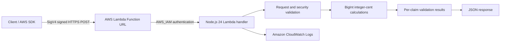

# RevenueGuard AWS — Serverless Financial Claim Validation

A serverless financial claim validation API built with **AWS Lambda, Node.js 24, GitHub Actions, and Amazon CloudWatch**.

RevenueGuard AWS validates submitted financial claims against synthetic, hard-coded transactions using exact integer-cent arithmetic, automated security tests, and authenticated HTTPS requests.

**Project status:** Deployed and tested on AWS Lambda.

> **Disclaimer:** This is a portfolio learning project using synthetic financial data. It is not a production financial service.

## Architecture



### Request processing

1. The client submits financial claims through an authenticated Lambda Function URL or a direct Lambda invocation.
2. The handler validates the request method, JSON body, payload size, and claim structure.
3. Financial amounts are processed using integer cents with `BigInt`.
4. Submitted claims are compared against trusted totals derived from synthetic transactions.
5. The API returns an `ACCEPTED` or `REJECTED` verdict.
6. AWS Lambda automatically publishes execution metrics and logs to Amazon CloudWatch.

## Features

- Serverless API using AWS Lambda and Node.js 24.
- AWS IAM-authenticated HTTPS Function URL.
- Exact financial calculations using `BigInt`.
- Validation of 1–20 financial claims per request.
- Detection of duplicate claims, unsupported identifiers, malformed amounts, and mismatched values.
- HTTP method restrictions with POST-only access.
- Request body size limit of 16 KB.
- Strict Base64 and UTF-8 request handling.
- Automated local regression and security testing.
- GitHub Actions CI and Lambda deployment artifact packaging.
- Basic AWS CloudWatch monitoring and execution logs.

## Financial validation logic

The application uses three synthetic financial transactions:

| Transaction | Type | Amount |
|---|---|---:|
| INV-101 | Sale | 500.00 |
| INV-102 | Sale | 750.00 |
| REF-103 | Refund | 125.00 |

### Derived financial totals

| Metric | Amount |
|---|---:|
| Gross sales | 1250.00 |
| Refunds | 125.00 |
| Net sales | 1125.00 |

All calculations use integer cents to avoid floating-point precision problems.

## API behavior

| Scenario | HTTP status | Result |
|---|---|---|
| Valid financial claims | 200 | ACCEPTED |
| Incorrect financial claim | 200 | REJECTED |
| Unsupported HTTP method | 405 | REJECTED |
| Malformed JSON | 400 | REJECTED |
| Invalid request structure | 400 | REJECTED |
| Oversized HTTP request | 413 | REJECTED |

Business-rule rejection is distinct from HTTP request failure. A well-formed request containing an incorrect financial claim can return HTTP 200 with a `REJECTED` verdict.

## Run locally

### Requirements

- Node.js 24
- Git
- A local copy of this repository

Clone the repository:

```bash
git clone https://github.com/yusufthecoder474/RevenueGuard-AWS.git
cd RevenueGuard-AWS
```

Check the Lambda source syntax:

```bash
node --check source/index.mjs
```

Run the complete Node.js test suite:

```bash
node --test test_local.mjs test_security.mjs test_phase3.mjs
```

### Previously verified local results

- 11 original business-validation scenarios passed.
- 15 Phase 2 security regression tests passed.
- 14 Phase 3 HTTP security tests passed.
- 30/30 tests reported by the combined Node.js test runner.

**Test-count note:** The original 11 business-validation scenarios execute within one Node.js test-runner test, so the combined runner reports 30 tests rather than 40.

## Continuous integration and packaging

The repository contains two GitHub Actions workflows.

### Continuous integration

**File:** `.github/workflows/ci.yml`

Runs automated validation without requiring AWS credentials.

### Lambda deployment packaging

**File:** `.github/workflows/package.yml`

Automates the following operations:

1. Runs automated tests.
2. Packages the Lambda handler into a ZIP file.
3. Checks the ZIP archive contents.
4. Verifies the packaged JavaScript syntax.
5. Uploads a downloadable deployment artifact to GitHub Actions.

The packaging workflow successfully completed on commit `5a22992`, producing a downloadable Lambda deployment artifact.

**Security:** AWS access keys are not stored in the repository, and the packaging workflow does not automatically deploy to AWS.

## AWS deployment

### Verified deployment configuration

| Configuration | Value |
|---|---|
| Cloud platform | AWS Lambda |
| Function name | `revenueguard-validation-api` |
| Runtime | Node.js 24 |
| Region | `ap-southeast-2` |
| Handler | `index.handler` |
| Function URL authentication | `AWS_IAM` |
| Deployment package | ZIP archive |

### Deployment procedure

1. Open the repository's **Actions** tab.
2. Select the **RevenueGuard Lambda Package** workflow.
3. Open a successful workflow run.
4. Download the Lambda deployment artifact.
5. Extract the downloaded GitHub Actions artifact ZIP.
6. Locate the inner `revenueguard-lambda.zip` package.
7. Upload the inner deployment ZIP to AWS CloudShell.
8. Deploy the ZIP to the existing Lambda function.
9. Wait for the Lambda update to complete.
10. Verify the deployed function and run a smoke test.

Example AWS CLI deployment:

```bash
aws lambda update-function-code \
  --function-name revenueguard-validation-api \
  --region ap-southeast-2 \
  --zip-file fileb://revenueguard-lambda.zip
```

The command assumes the deployment ZIP is in the current directory. Otherwise, provide its full path.

Wait for the update:

```bash
aws lambda wait function-updated \
  --function-name revenueguard-validation-api \
  --region ap-southeast-2
```

Verify the deployment:

```bash
aws lambda get-function-configuration \
  --function-name revenueguard-validation-api \
  --region ap-southeast-2 \
  --query '{State:State,UpdateStatus:LastUpdateStatus}' \
  --output json
```

Expected successful configuration:

```json
{
  "State": "Active",
  "UpdateStatus": "Successful"
}
```

### Authentication

The Lambda Function URL uses `AWS_IAM` authentication.

External HTTPS requests must be signed with AWS Signature Version 4 using credentials with the appropriate Lambda invocation permissions.

**Do not change the Function URL authentication to public `NONE` merely to simplify testing.**

Use least-privilege IAM policies and configure AWS billing safeguards.

## Verification results

### Local automated testing

| Test category | Verified result |
|---|---:|
| Original business-validation scenarios | 11 passed |
| Phase 2 security tests | 15 passed |
| Phase 3 HTTP security tests | 14 passed |
| Combined Node.js test runner | 30/30 passed |

### Live AWS Lambda verification

During the initial deployment:

- 5/5 direct AWS Lambda invocation tests passed.
- 5/5 authenticated HTTPS Function URL tests passed.
- Verified valid claims, incorrect claims, unsupported HTTP methods, malformed JSON, and oversized requests.

Following the later packaged deployment:

- Lambda reported `State: Active`.
- Lambda reported `LastUpdateStatus: Successful`.
- The Function URL retained `AWS_IAM` authentication.
- A post-deployment GET-request smoke test passed.
- The AWS Lambda invocation returned status code 200 with no function error.
- The application correctly returned HTTP 405 for the unsupported GET request.

The complete live regression suites have not yet been rerun following the packaged deployment.

### AWS CloudWatch observability

The deployed Lambda function was inspected using Amazon CloudWatch in `ap-southeast-2`.

**Observed Lambda metrics from a selected three-hour monitoring window:**

| Metric | Observed value |
|---|---:|
| Invocations | 11 |
| Lambda execution errors (maximum displayed) | 0 |
| Throttles (maximum displayed) | 0 |
| Average duration displayed | 21.85 ms |

**Verified execution log from one invocation:**

| Metric | Observed value |
|---|---:|
| Execution duration | 68.58 ms |
| Billed duration | 187 ms |
| Initialization duration | 118.23 ms |
| Configured memory | 128 MB |
| Maximum memory used | 76 MB |
| Approximate memory utilization | 59.4% |

**CloudWatch log group:**

```text
/aws/lambda/revenueguard-validation-api
```

Observed log records included:

- `INIT_START`
- `START`
- `END`
- `REPORT`

These measurements represent a limited demonstration workload. They are not load-test results, production latency guarantees, or an availability SLA.

No custom monitoring dashboard or paid advanced observability feature was required for this verification.

## Project structure

```text
RevenueGuard-AWS/
├── .github/
│   └── workflows/
│       ├── ci.yml
│       └── package.yml
├── source/
│   └── index.mjs
├── test_local.mjs
├── test_security.mjs
├── test_phase3.mjs
├── test_revenueguard.py
├── test_revenueguard_http.py
├── .gitattributes
└── README.md
```

### File descriptions

| File | Purpose |
|---|---|
| `source/index.mjs` | AWS Lambda financial claim validation handler |
| `test_local.mjs` | Local business-validation regression tests |
| `test_security.mjs` | Phase 2 security and boundary regression tests |
| `test_phase3.mjs` | Phase 3 HTTP security and request validation tests |
| `test_revenueguard.py` | AWS Lambda business-rule integration tests |
| `test_revenueguard_http.py` | AWS Lambda HTTP event integration tests |
| `.github/workflows/ci.yml` | Credential-free automated CI checks |
| `.github/workflows/package.yml` | Automated Lambda ZIP packaging, verification, and downloadable GitHub Actions artifact |
| `README.md` | Project documentation |

## Security considerations

The application includes:

- IAM-authenticated HTTPS access.
- POST-only HTTP handling.
- Strict request validation.
- Request size restrictions.
- Integer-cent financial arithmetic.
- Automated security regression tests.

Production readiness would additionally require authenticated and authorized access to real source data, structured application monitoring, rate limiting, comprehensive error handling, data governance, and a documented threat model.

**Never commit AWS access keys, secret keys, or temporary session credentials to GitHub.**

## Limitations

This project uses synthetic, hard-coded financial transactions and does not access production customer data.

Basic AWS CloudWatch metrics and execution logs have been verified. Production-grade monitoring, alerting, load testing, and availability SLAs have not been established.

The Python AWS integration tests require configured AWS credentials, boto3, and appropriate Lambda permissions. They are not part of the default credential-free GitHub Actions workflow.

## License

No license has been selected. Add a `LICENSE` file after choosing the terms under which the source code may be reused or distributed.