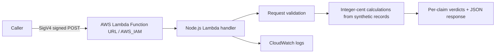

# RevenueGuard AWS — Serverless Financial Claim Validation

A small, independently deployable AWS Lambda demonstration that checks submitted financial claims against **synthetic, hard-coded transactions**. This is a portfolio learning project, not a production financial data service.

## Architecture



## Behavior

- Three synthetic records: sales of 500.00 and 750.00, and a refund of 125.00.
- Derived trusted totals: gross sales **1250.00**, refunds **125.00**, net sales **1125.00**.
- Checks 1–20 claims, rejects duplicates, unsupported identifiers, invalid decimal formats and mismatched amounts.
- Uses `BigInt` integer cents rather than floating-point arithmetic.
- Returns HTTP 400 for malformed JSON or invalid claim counts; returns HTTP 200 with a `REJECTED` verdict for business-rule failures.
- Supports direct Lambda test events and HTTP Function URL event bodies.

## Run locally

Install Node.js 24 and run:

```bash
node --check source/index.mjs
node --test test_local.mjs
```

## AWS deployment

Deploy `source/index.mjs` as `index.mjs` in a Node.js 24 Lambda with handler `index.handler`. For external HTTPS requests, create a Lambda Function URL with **AWS_IAM** authorization and sign requests with AWS Signature Version 4. Do **not** switch to public `NONE` authentication merely to simplify testing. Apply least-privilege IAM permissions and configure billing alerts.

The Python files `test_revenueguard.py` and `test_revenueguard_http.py` invoke the named AWS function in `ap-southeast-2` and require boto3, configured AWS credentials and suitable Lambda invoke permission. They are **integration tests**, not part of the default GitHub Actions job. No AWS credentials are stored in this repository.

## Evidence and limitations

Screenshots provided by the project author show 11/11 AWS Lambda business-validation tests, 3/3 HTTP-event tests and an authenticated Function URL request returning HTTP 200. These are **user-provided historical execution results**, not independent AWS reruns by this package. Local CI tests run separately. No production dataset, customer records, throughput benchmark, availability SLA or real-world accuracy claim is implied.

## Project structure

- `source/index.mjs` — Lambda implementation
- `test_local.mjs` — local Node.js regression checks
- `test_revenueguard.py` — AWS business-rule integration tests
- `test_revenueguard_http.py` — AWS HTTP event integration tests
- `.github/workflows/ci.yml` — credential-free CI checks

## Security

This demo uses hard-coded synthetic facts. Production readiness would require authenticated and authorized source-data access, input size limits, structured monitoring, rate limiting, error handling, data governance and a threat model. Never commit AWS access keys.

## License

No license has been selected. Add a LICENSE file only after choosing the terms under which you wish to share this code.
