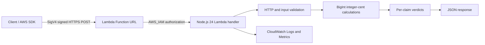

# RevenueGuard AWS — Serverless Financial Claim Validation

A serverless financial claim validation API built with **AWS Lambda, Node.js 24, GitHub Actions, and Amazon CloudWatch**.

RevenueGuard AWS checks submitted financial claims against **synthetic, hard-coded transactions**, using exact integer-cent arithmetic, automated regression tests, and IAM-authenticated HTTPS requests.

**Project status:** Deployed and verified on AWS Lambda (`ap-southeast-2`).

> **Disclaimer:** This is a portfolio learning project, not a production financial service. It does not process real customer transactions.

## Architecture



**Request flow:** The caller signs an HTTPS POST with AWS Signature Version 4, or invokes Lambda directly using an authorized AWS SDK. The handler checks the request boundary, parses JSON, validates 1–20 claims, compares values with synthetic trusted totals, and returns `ACCEPTED` or `REJECTED` results. Lambda also publishes execution logs and metrics to CloudWatch.

## Features

- AWS Lambda handler running Node.js 24.
- AWS IAM-authenticated Lambda Function URL; no publicly unauthenticated endpoint is required.
- Exact financial calculations using `BigInt` integer cents instead of floating-point arithmetic.
- Validation of 1–20 claims per request, with duplicate and unsupported fact detection.
- Rejection of malformed decimal values, incorrect totals, and missing fact identifiers.
- POST-only HTTP handling; unsupported methods return HTTP 405.
- HTTP request-body limit of 16 KiB, with Base64 and UTF-8 validation.
- Credential-free GitHub Actions testing and downloadable Lambda ZIP packaging.
- Basic CloudWatch runtime metrics and invocation logs.

## Synthetic financial dataset

| Transaction | Type | Amount |
|---|---|---:|
| `INV-101` | Sale | 500.00 |
| `INV-102` | Sale | 750.00 |
| `REF-103` | Refund | 125.00 |

Derived totals:

| Claim `fact_id` | Trusted value |
|---|---:|
| `gross_sales` | `1250.00` |
| `refunds` | `125.00` |
| `net_sales` | `1125.00` |

Amounts must be supplied as decimal **strings**, not JSON numbers.

## API example

### Valid request body

```json
{
  "claims": [
    { "fact_id": "gross_sales", "value": "1250.00" },
    { "fact_id": "refunds", "value": "125.00" },
    { "fact_id": "net_sales", "value": "1125.00" }
  ]
}
```

### Expected successful response body

```json
{
  "status": "ACCEPTED",
  "dataset": "synthetic-demo-v1",
  "checks": [
    { "fact_id": "gross_sales", "verdict": "ACCEPTED", "reason": "Matches trusted source calculation" },
    { "fact_id": "refunds", "verdict": "ACCEPTED", "reason": "Matches trusted source calculation" },
    { "fact_id": "net_sales", "verdict": "ACCEPTED", "reason": "Matches trusted source calculation" }
  ]
}
```

### HTTP and business-rule behavior

| Scenario | HTTP status | Application verdict |
|---|---:|---|
| Valid financial claims | 200 | `ACCEPTED` |
| Incorrect financial claim | 200 | `REJECTED` |
| Unsupported HTTP method | 405 | `REJECTED` |
| Malformed JSON | 400 | `REJECTED` |
| Missing or invalid claim list | 400 | `REJECTED` |
| Oversized HTTP body | 413 | `REJECTED` |

**Important:** A syntactically valid request containing an incorrect amount returns HTTP 200 with a business-level `REJECTED` verdict. The API does not equate a business-rule rejection with a transport error.

## Run locally

### Prerequisites

- Node.js 24
- Git

```bash
git clone https://github.com/yusufthecoder474/RevenueGuard-AWS.git
cd RevenueGuard-AWS
node --check source/index.mjs
node --test test_local.mjs test_security.mjs test_phase3.mjs
```

Previously verified local results:

| Suite | Result |
|---|---:|
| Original business-validation scenarios | 11 passed |
| Phase 2 security regression tests | 15 passed |
| Phase 3 HTTP security regression tests | 14 passed |
| Combined Node.js test-runner report | **30/30 passed** |

The 11 original scenarios are executed within one Node.js test-runner test, so the combined runner reports 30 tests rather than the arithmetic sum of all scenario counts.

## Continuous integration and packaging

Two workflows run from `.github/workflows/`:

- **`ci.yml` — RevenueGuard Lambda CI:** Runs syntax validation and the three local test suites on pushes and pull requests. It requires no AWS credentials.
- **`package.yml` — RevenueGuard Lambda Package:** Runs syntax checks and the combined regression suite, packages `source/index.mjs` as `index.mjs` at the ZIP root, verifies ZIP contents and syntax, and uploads a downloadable GitHub Actions artifact.

The packaging workflow previously succeeded at commit `5a22992` and produced a Lambda deployment artifact. A subsequent documentation commit `34fb93a` passed the CI workflow. These are separate workflow results; the ZIP packaging workflow does **not** automatically deploy to AWS.

**Artifact layout:** The downloaded GitHub Actions artifact is an outer archive named like `revenueguard-lambda-<commit>.zip`. Extract it first to obtain the inner **`revenueguard-lambda.zip`** deployment package. Upload the inner ZIP to Lambda, not the outer artifact archive.

## AWS deployment

### Verified environment

| Setting | Value |
|---|---|
| AWS service | Lambda |
| Function | `revenueguard-validation-api` |
| Region | `ap-southeast-2` |
| Runtime | `nodejs24.x` |
| Handler | `index.handler` |
| Package type | ZIP |
| Function URL authorization | `AWS_IAM` |

### Deploy an already packaged ZIP

1. Open **GitHub → Actions → RevenueGuard Lambda Package** and choose a successful run.
2. Download the `revenueguard-lambda-<commit>` artifact.
3. Extract the downloaded artifact and locate its inner `revenueguard-lambda.zip`.
4. Upload the inner ZIP to **AWS CloudShell in `ap-southeast-2`**.
5. Run the commands below, substituting the actual ZIP path.

```bash
aws lambda update-function-code \
  --function-name revenueguard-validation-api \
  --region ap-southeast-2 \
  --zip-file fileb://revenueguard-lambda.zip

aws lambda wait function-updated \
  --function-name revenueguard-validation-api \
  --region ap-southeast-2

aws lambda get-function-configuration \
  --function-name revenueguard-validation-api \
  --region ap-southeast-2 \
  --query '{State:State,UpdateStatus:LastUpdateStatus,Runtime:Runtime}' \
  --output json
```

The example assumes the inner ZIP is in the current CloudShell directory. Otherwise, use its absolute path after `fileb://`.

A successful update should report `State: Active` and `UpdateStatus: Successful`. A successful update does not, by itself, prove the deployed behavior; run post-deployment regression tests as well.

### Access control

The Lambda Function URL is configured with **`AWS_IAM`** authorization. HTTPS clients must sign requests using AWS Signature Version 4 and possess the required Lambda Function URL invocation permissions. Direct AWS SDK invocation requires the relevant Lambda invoke permission. Keep permissions least-privileged, avoid committing credentials, and configure billing safeguards.

**Do not switch the Function URL to public `NONE` authentication to simplify testing.**

## Verification evidence — 31 October 2026

### Post-deployment Phase 8 regression results

The latest packaged Lambda deployment was followed by the checks below:

| Verification | Observed result |
|---|---|
| Lambda state | `Active` |
| Last update status | `Successful` |
| Function URL authorization | `AWS_IAM` retained |
| Unsupported GET smoke test | Application HTTP 405; direct Lambda invocation successful |
| HTTP event security regression | **5/5 passed** |
| Financial business-rule regression via Lambda SDK | **5/5 passed** |
| Financial business-rule regression via SigV4 HTTPS | **5/5 passed** |

The five HTTP event security checks covered GET, PUT, DELETE, malformed JSON, and an oversized body. The financial regression checks covered correct gross sales, incorrect gross sales, correct refunds, correct net sales, and incorrect net sales. The HTTPS tests returned HTTP 200 with the expected `ACCEPTED` or `REJECTED` application verdict and checked the per-claim reason.

**Scope:** These are limited functional and security regression checks against the deployed demo, not a load test or proof of production readiness. The two sets of five financial tests use different invocation paths; they are not ten distinct financial scenarios.

### Earlier live deployment checks

Before the latest packaged deployment, an earlier live verification also reported:

- **5/5** direct Lambda invocation tests passed.
- **5/5** IAM-authenticated HTTPS Function URL tests passed.

Those earlier runs covered valid claims, incorrect claims, unsupported HTTP methods, malformed JSON, and oversized requests. They are historical evidence, not additional Phase 8 executions.

### CloudWatch observability

The Lambda function was inspected in Amazon CloudWatch in `ap-southeast-2`.

**Selected three-hour monitoring window (historical observation):**

| Metric | Displayed observation |
|---|---:|
| Invocations | 11 |
| Lambda execution errors (maximum displayed) | 0 |
| Throttles (maximum displayed) | 0 |
| Average duration displayed | 21.85 ms |

**One inspected `REPORT` log event:**

| Metric | Observed value |
|---|---:|
| Execution duration | 68.58 ms |
| Billed duration | 187 ms |
| Initialization duration | 118.23 ms |
| Configured memory | 128 MB |
| Maximum memory used | 76 MB |
| Maximum memory / configured memory | Approximately 59.4% |

**Log group:** `/aws/lambda/revenueguard-validation-api`

CloudWatch log records included `INIT_START`, `START`, `END`, and `REPORT`. These values describe a limited demonstration workload and a selected log event. They are not p95 latency, sustained throughput, production performance targets, or an availability SLA. No custom paid monitoring dashboard was required for this observation.

## Project structure

```text
RevenueGuard-AWS/
├── .github/
│   └── workflows/
│       ├── ci.yml
│       └── package.yml
├── source/
│   └── index.mjs
├── test_local.mjs
├── test_security.mjs
├── test_phase3.mjs
├── test_revenueguard.py
├── test_revenueguard_http.py
├── .gitattributes
└── README.md
```

| File | Purpose |
|---|---|
| `source/index.mjs` | Lambda handler and financial validation rules |
| `test_local.mjs` | Original business-validation scenarios |
| `test_security.mjs` | Phase 2 security and boundary regression tests |
| `test_phase3.mjs` | Phase 3 HTTP and request security tests |
| `test_revenueguard.py` | AWS Lambda business-rule integration test script |
| `test_revenueguard_http.py` | AWS Lambda HTTP event integration test script |
| `.github/workflows/ci.yml` | Credential-free CI checks |
| `.github/workflows/package.yml` | Automated Lambda ZIP packaging, verification, and downloadable GitHub Actions artifact |
| `README.md` | Project documentation |

The Python integration scripts require `boto3`, AWS credentials, and appropriate permissions; they are **not** part of the default credential-free GitHub Actions workflows. The Phase 8 live checks were also executed manually through AWS CloudShell.

## Security considerations

**Implemented in this demo:** IAM-authenticated HTTPS access, POST-only HTTP handling, input structure checks, a 16 KiB HTTP body limit, Base64/UTF-8 validation, integer-cent arithmetic, and automated security regression tests.

**Not established as production-ready:** Authorized access to real financial source systems, data governance, rate limiting, comprehensive application monitoring and alerting, a formal threat model, production load testing, and availability guarantees. Never commit AWS access keys, secret keys, or session credentials to GitHub.

## Cost and operational limitations

This project uses synthetic data only. AWS Lambda and CloudWatch usage can incur charges depending on account allowances and consumption; review AWS Billing and set appropriate account spending controls. The repository's CI and ZIP packaging do not need AWS credentials and do not automatically create or update AWS resources.

## License

No license has been selected. Add a `LICENSE` file only after choosing the terms under which others may reuse or redistribute this code.

## GitHub Actions Upgrade Verification — 31 October 2026

The GitHub Actions workflows were upgraded to Node.js 24-compatible action versions through pull request #1.

### Verified results

| Item | Result |
|---|---|
| Pull request | #1 — MERGED |
| Merge commit | `262a1cbbdc1b86fdf42430026db85081b8d83cd6` |
| CI workflow | SUCCESS |
| CI run ID | `41219909447` |
| Lambda packaging workflow | SUCCESS |
| Packaging run ID | `41219909413` |

### GitHub Actions versions

- `actions/checkout@v5`
- `actions/setup-node@v5`
- `actions/upload-artifact@v5`

The upgrade preserves the AWS Lambda application, existing regression tests, IAM authentication, and ZIP packaging behavior.

The CI workflow performs JavaScript syntax validation and automated regression testing.

The packaging workflow tests the application, creates the Lambda ZIP, verifies its contents, and uploads the deployment artifact.

Both workflows completed successfully on the `main` branch after the upgrade.

### Verification links

- [Merged upgrade PR](https://github.com/yusufthecoder474/RevenueGuard-AWS/pull/1)
- [Successful CI run](https://github.com/yusufthecoder474/RevenueGuard-AWS/actions/runs/41219909447)
- [Successful packaging run](https://github.com/yusufthecoder474/RevenueGuard-AWS/actions/runs/41219909413)

**Deployment note:** The packaging workflow produces a deployment artifact but does not automatically deploy to AWS. The existing Lambda deployment remains separate.

